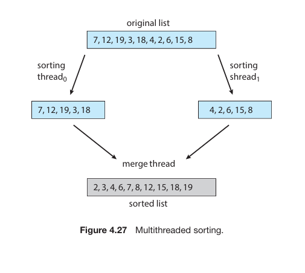

# Multithreaded Sorting Application · V-1-6

---

- **Хичээл:** F.CSM302 Үйлдлийн систем
- **Багийн дугаар:** V-1-6
- **Сурах бичгийн харгалзах бүлэг:** 4-р бүлэг - (Threads & Concurrency)
- **Төслийн нэр:** Multithreaded Sorting Application
- **UI дүрслэл:** Sorting animation

## Багийн гишүүд

| Оюутны код | Нэр |
| :--- | :--- |
| B231910001 | Л.Батзориг |
| B241910003 | Б.Эрдэнэжаргал |
| B241910026 | Б.Заяабуян |
| B241940015 | Б.Хүслэн |
| B242270135 | М.Мөнхүүжин |

## Зорилго

Бүхэл тоон жагсаалтыг хоёр хэсэгт хувааж, 2 sorting thread болон 1 merge thread ашиглан гүйцэтгэх олон урсгалт эрэмбэлэлтийг (Multithreaded Sorting Application) JavaScript Web Worker ашиглан хэрэгжүүлэх. Thread бүр өөрийн бодит үйлдлийг дүрслэлд илгээх ба эрэмбэлэлт, нэгтгэлтийн явцыг browser дээр Sorting animation-аар алхам алхмаар, интерактив байдлаар бодитоор харуулах юм. Ямар нэгэн нэмэлт суулгац шаардалгүйгээр `src/index.html`-ийг шууд нээж турших боломжтой.

## Дэлгэцийн зураг



## Quick Start

**Шаардлага:** **Web Worker** дэмждэг орчин үеийн веб браузер (`Chrome`, `Edge`, `Firefox`, `Safari`). Node.js, компилятор болон нэмэлт сан `npm install` шаардлагагүй (Windows, macOS, Linux дээр ижил ажиллана).

```bash
# Төслийг өөрийн desktop-руу татаж авах
git clone https://github.com/Zaya898/OperatingSystems-F.CSM302.git
cd OperatingSystems-F.CSM302 ```

### Ажиллуулах аргууд

| Арга | Алхам |
| :--- | :--- |
| **Хамгийн хялбар** | `src/index.html` файлыг давхар товшиж browser дээр шууд нээнэ. |
| **Локал сервер (Python)** | `cd src && python -m http.server 8000` ажиллуулаад браузерт `http://localhost:8000` хаягаар орно. |
| **Локал сервер (Node)** | `cd src && npx serve .` командыг ажиллуулна. |

> **Тэмдэглэл:** Нээмэгц үндсэн сурах бичгийн *Figure 4.27*-ийн жишээ (`7, 12, 19, 3, 18, 4, 2, 6, 15, 8`) өгөгдлүүд бэлэн байх ба **Эхлүүлэх** товчийг дарж туршина.

## Дэлгэцийн зураг

