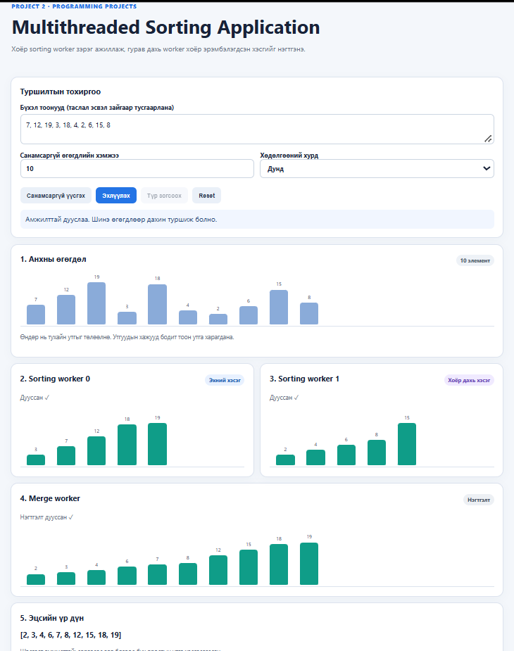

# Multithreaded Sorting Application · V-1-6

---

- **Хичээл:** F.CSM302 Үйлдлийн систем
- **Багийн дугаар:** V-1-6
- **Сурах бичгийн харгалзах бүлэг:** 4-р бүлэг - (Threads & Concurrency)
- **Төслийн нэр:** Multithreaded Sorting Application
- **UI дүрслэл:** Sorting animation

## Багийн гишүүд

| Оюутны код | Нэр |
| :--- | :--- |
| B231910001 | Л.Батзориг |
| B241910003 | Б.Эрдэнэжаргал |
| B241910026 | Б.Заяабуян |
| B241940015 | Б.Хүслэн |
| B242270135 | М.Мөнхүүжин |

## Зорилго

Бүхэл тоон жагсаалтыг хоёр хэсэгт хувааж, 2 sorting thread болон 1 merge thread ашиглан гүйцэтгэх олон урсгалт эрэмбэлэлтийг (Multithreaded Sorting Application) JavaScript Web Worker ашиглан хэрэгжүүлэх. Thread бүр өөрийн бодит үйлдлийг дүрслэлд илгээх ба эрэмбэлэлт, нэгтгэлтийн явцыг browser дээр Sorting animation-аар алхам алхмаар, интерактив байдлаар бодитоор харуулах юм. Ямар нэгэн нэмэлт суулгац шаардалгүйгээр `src/index.html`-ийг шууд нээж турших боломжтой.

## Дэлгэцийн зураг



## Quick Start

**Шаардлага:** **Web Worker** дэмждэг орчин үеийн веб браузер (`Chrome`, `Edge`, `Firefox`, `Safari`). Node.js, компилятор болон нэмэлт сан `npm install` шаардлагагүй (Windows, macOS, Linux дээр ижил ажиллана).

```bash
# 1. Төслийг өөрийн desktop-руу татаж авах
git clone https://github.com/Zaya898/OperatingSystems-F.CSM302.git
cd OperatingSystems-F.CSM302

### Ажиллуулах аргууд

| Арга | Алхам |
| :--- | :--- |
| **Хамгийн хялбар** | `src/index.html` файлыг давхар товшиж browser дээр шууд нээнэ. |
| **Локал сервер (Python)** | `cd src && python -m http.server 8000` ажиллуулаад браузерт `http://localhost:8000` хаягаар орно. |
| **Локал сервер (Node)** | `cd src && npx serve .` командыг ажиллуулна. |

> **Тэмдэглэл:** Нээмэгц үндсэн сурах бичгийн *Figure 4.27*-ийн жишээ (`7, 12, 19, 3, 18, 4, 2, 6, 15, 8`) өгөгдлүүд бэлэн байх ба **Эхлүүлэх** товчийг дарж туршина.

## Дэлгэцийн зураг


## Юу хийж болох вэ

| Хэсэг / Үйлдэл | Тайлбар |
| :--- | :--- |
| **Туршилтын тохиргоо** | Бүхэл тоонуудаа гараар оруулна (таслал, зай, `;`-аар тусгаарлана; сөрөг тоо дэмжинэ) эсвэл хэмжээг (2–200) өгөөд **Санамсаргүй үүсгэх** дарна. |
| **Хурд** | Удаан (700 мс) · Дунд (350 мс) · Хурдан (100 мс) · Шууд (анимацигүй). Ажиллаж байх үед ч солигдоно. |
| **Эхлүүлэх** | Хоёр sorting worker зэрэг эхэлнэ; хоёулаа дуусмагц merge worker автоматаар эхэлнэ. |
| **Түр зогсоох / Үргэлжлүүлэх** | Идэвхтэй бүх worker-ийг бодитоор зогсоож, үргэлжлүүлнэ. |
| **Reset** | Worker-үүдийг зогсоож дүрслэлийг эхний төлөвт буцаана (оролт хадгалагдана). |
| **1–5-р самбар** | Анхны өгөгдөл, Sorting worker 0, Sorting worker 1, Merge worker, Эцсийн үр дүн (автомат баталгаажуулалт ба хэмжүүртэй). |

## Дүрслэлийн тэмдэглэгээ

| Тэмдэг / Элемент | Утга / Тайлбар |
| :--- | :--- |
| **Баганын өндөр** | Утгын хэмжээ (хамгийн бага утгаас хамгийн их утга хүртэл масштабласан) |
| **Баганын дээрх тоо** | Элементийн бодит утга |
| **Цайвар цэнхэр багана** | Боловсруулагдаж буй, эрэмбэлэгдээгүй утга |
| **Улбар шар багана** | Одоо идэвхтэй элемент (солигдож буй эсвэл нэгтгэгдэж буй) |
| **Ногоон багана** | Эрэмбэлэгдсэн хэсэг буюу эцсийн үр дүн |
| **Хүлээж байна → Эрэмбэлж байна… → Дууссан ✓** | Sorting worker-ийн төлөв |
| **Нэгтгэж байна… (k/n) → Нэгтгэлт дууссан ✓** | Merge worker-ийн төлөв |
| **Түр зогссон** | Pause дарсан үеийн төлөв |
| **Улаан мэдээлэл** | Оролт эсвэл Worker-ийн алдаа |

## Жишээ

| Жишээ | Оролт | Хүлээгдэх үр дүн |
| :--- | :--- | :--- |
| **Номын Figure 4.27** | `7, 12, 19, 3, 18, 4, 2, 6, 15, 8` | `2, 3, 4, 6, 7, 8, 12, 15, 18, 19` |
| **Сөрөг утгатай** | `-5, 3, -1, 0` | `-5, -1, 0, 3` |
| **Давхардсан утгатай** | `4, 2, 4, 1, 2` | `1, 2, 2, 4, 4` |
| **Хамгийн том оролт** | Санамсаргүй үүсгэх, хэмжээ 200, хурд Шууд | Эрэмбэлэгдсэн 200 тоо, "Шалгалт амжилттай" |