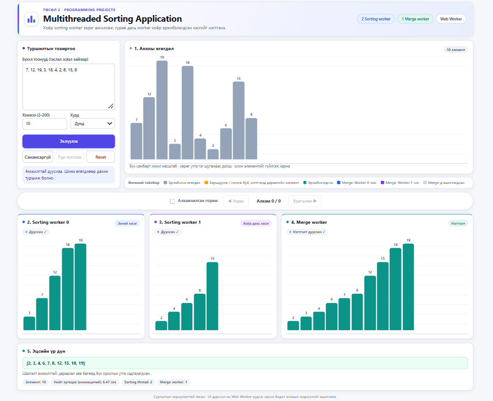
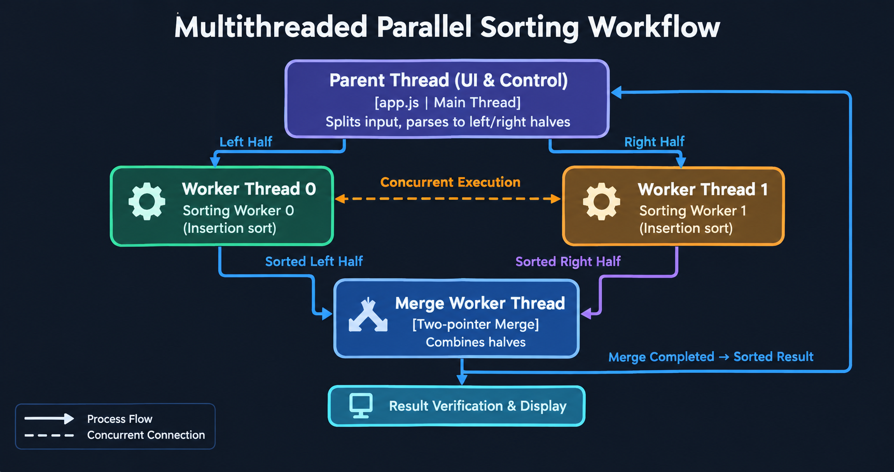

# Multithreaded Sorting Application · V-1-6

---

- **Хичээл:** F.CSM302 Үйлдлийн систем
- **Багийн дугаар:** V-1-6
- **Сурах бичгийн харгалзах бүлэг:** 4-р бүлэг - (Threads & Concurrency)
- **Төслийн нэр:** Multithreaded Sorting Application
- **UI дүрслэл:** Sorting animation

## Багийн гишүүд

| Оюутны код | Нэр |
| :--- | :--- |
| B210900026 | О.Хишигжаргал |
| B231910001 | Л.Батзориг |
| B241910003 | Б.Эрдэнэжаргал |
| B241910026 | Б.Заяабуян |
| B241940015 | Б.Хүслэн |
| B242270135 | М.Мөнхүүжин |

## Зорилго

Энэхүү програм нь бүхэл тоон жагсаалтыг хоёр хэсэгт хувааж, хэсэг тус бүрийг хоёр Sorting Web Worker ашиглан зэрэг эрэмбэлнэ. Үүний дараа Merge Web Worker хоёр эрэмбэлэгдсэн хэсгийг нэгтгэнэ. Програм нь энэхүү олон урсгалт эрэмбэлэлтийн ажиллагааг browser дээр хөдөлгөөнт дүрслэлээр харуулна.
Worker бүр ажиллах явцдаа хийгдэж буй алхмуудаа postMessage ашиглан UI руу илгээх бөгөөд UI эдгээр мэдээллийг хүлээн авч, эрэмбэлэлтийн явцыг шууд дүрслэн харуулна. Ингэснээр хэрэглэгч эрэмбэлэлт хэрхэн явагдаж байгааг алхам бүрээр нь харах боломжтой.
Програмыг ажиллуулахын тулд нэмэлт build хийх эсвэл сервер асаах шаардлагагүй. src/index.html файлыг browser дээр нээхэд шууд ажиллана.

## Дэлгэцийн зураг


## Quick Start

**Шаардлага:** Web Worker дэмждэг browser (Chrome, Edge, Firefox, Safari). Node.js 16+ нь зөвхөн автомат тестэд хэрэгтэй. `npm install`, compiler шаардлагагүй.

```bash
git clone https://github.com/Zaya898/OperatingSystems-F.CSM302.git
cd OperatingSystems-F.CSM302
git checkout v2.0
```

### Ажиллуулах аргууд

| Арга | Алхам |
| :--- | :--- |
| **Хамгийн хялбар** | `src/index.html` файл дээр дарж browser дээр шууд нээнэ. |
| **Локал сервер (Python)** | `cd src && python -m http.server 8000` ажиллуулаад браузерт `http://localhost:8000` хаягаар орно. |
| **Локал сервер (Node)** | `cd src && npx serve .` командыг ажиллуулна. |

> **Тэмдэглэл:** Ажиллуулмагц үндсэн сурах бичгийн *Figure 4.27*-ийн жишээ (`7, 12, 19, 3, 18, 4, 2, 6, 15, 8`) өгөгдлүүд бэлэн байх ба **Эхлүүлэх** товчийг дарж туршина.

## Юу хийж болох вэ

| Үйлдэл | Тайлбар |
| :--- | :--- |
| **Оролт** | Бүхэл тоонуудыг таслал, зай, `;`, шинэ мөрөөр тусгаарлана (2–200 элемент, сөрөг тоо дэмжинэ). Эсвэл хэмжээ өгөөд **Санамсаргүй үүсгэх** дарна. |
| **Хурд** | Удаан (700 мс) · Дунд (350 мс) · Хурдан (100 мс) · Шууд (анимацигүй). Ажиллаж байхад ч солигдоно. |
| **Эхлүүлэх** | Хоёр sorting worker зэрэг эхэлнэ. Хоёулаа дуусмагц merge worker автоматаар эхэлнэ. |
| **Түр зогсоох / Үргэлжлүүлэх** | Ажиллаж буй worker-ийг бодитоор зогсооно. Дууссан worker «Дууссан ✓» хэвээр үлдэнэ. |
| **Reset** | Worker-үүдийг зогсоож дүрслэлийг эхний төлөвт буцаана (оролт хадгалагдана). |
| **Алхамчилсан горим** | Нүдийг идэвхжүүлээд **Эхлүүлэх** дарна. **Урагшлах ▶** (`→`) дарах бүрт worker бүр нэг үйлдэл хийнэ. **◀ Ухрах** (`←`) өмнөх төлөв рүү буцна. Pause, хурд энэ горимд хамаарахгүй. |


## Дүрслэлийн тэмдэглэгээ
 
Хуудсан дээр «Өнгөний тайлбар» (legend) харагдана. Бүх самбар **ижил масштабтай** (анхны өгөгдлийн min/max), сөрөг утга тэг шугамаас доош зурагдана.
 
| Тэмдэг | Утга |
| :--- | :--- |
| **Баганын өндөр / дээрх тоо** | Утгатай пропорциональ / бодит утга |
| **Цайвар цэнхэр** | Эрэмбэлэгдээгүй, боловсруулагдаж буй |
| **Улбар шар** | Одоо идэвхтэй (солигдож буй) элемент |
| **Ногоон** | Эрэмбэлэгдсэн хэсэг, эцсийн үр дүн |
| **Merge: цэнхэр / ягаан** | Элемент Worker 0 / Worker 1-ээс ирснийг заана |
| **Worker самбар: бүдэг / шар** | Merge-д ашиглагдсан / дараагийн харьцуулах элемент |
| **Улаан мэдээлэл** | Оролт эсвэл Worker-ийн алдаа |


## Жишээ
 
| Оролт | Хүлээгдэх үр дүн |
| :--- | :--- |
| `7, 12, 19, 3, 18, 4, 2, 6, 15, 8` (хуваалт 5+5) | `2, 3, 4, 6, 7, 8, 12, 15, 18, 19` |
| `-5, 3, -1, 0` | `-5, -1, 0, 3` |
| `4, 2, 4, 1, 2` | `1, 2, 2, 4, 4` |
| `8, 3, 1` (хуваалт 1+2) | `1, 3, 8` |
| Санамсаргүй, хэмжээ 200, хурд Шууд | Эрэмбэлэгдсэн 200 тоо, «Шалгалт амжилттай» |


## Оролтын шалгалт

| Нөхцөл | Харуулах мэдээлэл |
| :--- | :--- |
| Хоосон оролт | Жагсаалт хоосон байна. Хоёр ба түүнээс олон бүхэл тоо оруулна уу. |
| `1, abc, 3`, `2.5` | “abc” нь бүхэл тоо биш байна. |
| `1,,2`, төгсгөлийн таслал | Хоосон хэсэг байна. Тоонуудыг зөв тусгаарлана уу. |
| 1 элемент | Хамгийн багадаа 2 бүхэл тоо оруулна уу. |
| 200-аас олон элемент | Энэ хувилбар 200 хүртэлх элементийг дэмжинэ. |
| Аюулгүй бүхэл тооны хязгаараас том тоо | Хязгаараас хэтэрсэн тухай мэдээлэл |

## Хэрхэн ажилладаг


 
- **Хуваалт:** `half = ⌊n/2⌋`, сондгой үед 2-р хэсэг 1 элементээр том.
- **Sorting worker:** Insertion sort-ыг алхам бүрээр гүйцэтгэж `step` мессеж илгээнэ.
- **Merge worker:** `left[i] <= right[j]` нөхцөлөөр тогтвортой нэгтгэж, `leftIndex`/`rightIndex` илгээнэ.
- **Pause/Resume:** Worker алхам бүрийн өмнө `waitIfPaused()` шалгана.
- **Reset/`runId`:** Хуучин worker-ийн хоцорсон мессежийг үл тооно.
- **Blob URL:** Worker-ийг Blob URL-аар үүсгэдэг тул `file://` дээр ч ажиллана.

### Сурах бичгийн шаардлагатай тулгалт

| Шаардлага (Project 2) | Хэрэгжилт |
| :--- | :--- |
| Жагсаалтыг хоёр хэсэгт хуваах | `start()` дотор `half`-аар хуваана |
| Хоёр sorting thread | 2 Web Worker (`sortWorkerMain`) |
| Merging thread | 3-р Web Worker (`mergeWorkerMain`) |
| Thread бүрт өөрийн хэсгийг дамжуулах | `postMessage({type:"sort", workerId, values})` |
| Бүгд дууссаны дараа үр дүн гаргах | UI «Эцсийн үр дүн»-г гаргаж шалгана |
 
> **Хэрэгжилтийн ялгаа:** Ном глобал массивыг хуваалцахыг санал болгосон. Web Worker өгөгдөл хуваалцдаггүй тул хэсгийг `postMessage`-ээр дамжуулж, үр дүнг буцаан авна. Worker бүр зөвхөн өөрийн хэсэгтэй ажилладаг тул data race үүсэхгүй.


## Тест

- **Автомат:** `node src/tests/run-tests.js` → `27/27 амжилттай` (эрэмбэлэлт+нэгтгэл 10, зөв оролт 4, буруу оролт 12, алхамчилсан горим 1).
- **Гараар:** [`tests/test-cases.md`](tests/test-cases.md).
- **Туршсан орчин:** Linux x86_64, Chromium 153, Node.js v22. Safari, Firefox, Edge, Windows дээр туршаагүй.

## БД2: шүүмжийн дагуу хийсэн засвар
 
| Шүүмж | Түвшин | Засвар |
| :--- | :--- | :--- |
| Баганын масштаб самбар бүрд өөр байсан | Major | Бүх самбарт нэг масштаб, сөрөг утгад тэг шугам |
| `−` (U+2212) алдаа өгч, тестийн өгөгдөл зөрсөн | Minor | `−`-г `-` болгож хөрвүүлнэ, тестийн өгөгдлийг нэг эх сурвалжтай болгосон |
| Pause дарахад дууссан worker «Түр зогссон» болдог | Minor | Зөвхөн дуусаагүй worker-ийн төлөв өөрчлөгдөнө |
| Legend байхгүй, `leftIndex/rightIndex` ашиглаагүй | Minor | Legend нэмсэн, merge-д эх сурвалж ба дараагийн элементийг тодруулсан |
| `1,,2` алдаагүй ажиллаж байсан | Minor | Хоосон хэсэгт алдаа өгнө |
| Автомат тест байхгүй | Suggestion | `src/tests/run-tests.js` (27 тест) |
| «Шууд» горимд завсрын алхам харагдахгүй | Suggestion | Алхамчилсан горим (Урагшлах / Ухрах) нэмсэн |

## Бүтэц
 
```
src/      index.html, styles.css, app.js, input-utils.js, workers-code.js
src/tests/  run-tests.js (автомат тест)
tests/    test-cases.md
docs/     Final Report, Manual, Poster, зургууд
```
## Source

- **Диаграм (`docs/image-2.png`):** Урсгалыг paint дээр ерөнхийд нь зурж, дүрслэлийг ChatGPT-ээр гаргуулсан.
- **Сан:** Гадны сан, framework ашиглаагүй (цэвэр HTML, CSS, JavaScript).
- **Ном:** A. Silberschatz, P. B. Galvin, G. Gagne, *Operating System Concepts*, 10th Edition, Chapter 4, Programming Project 2.
