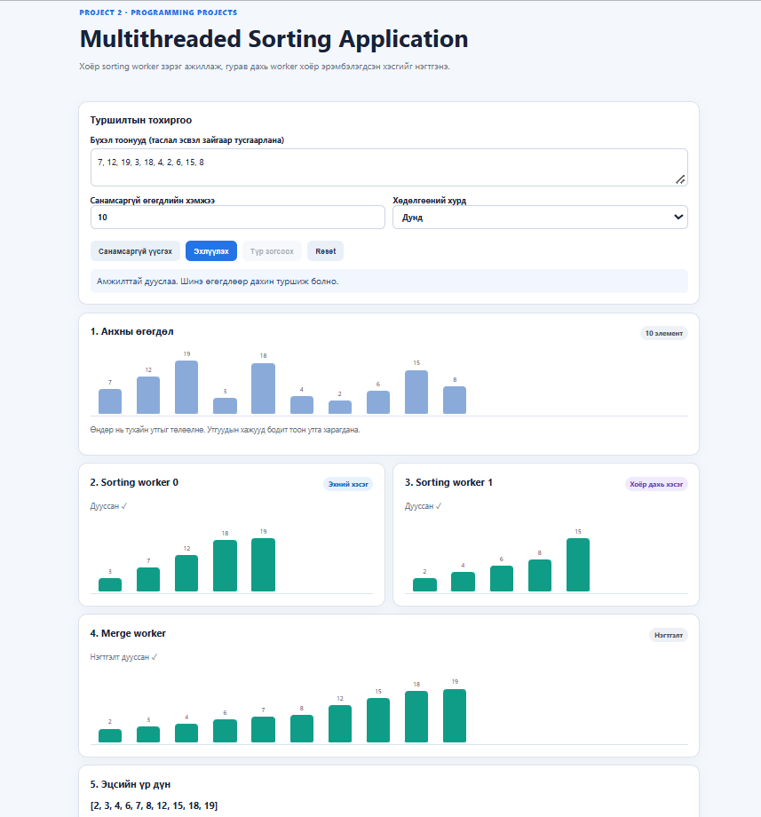
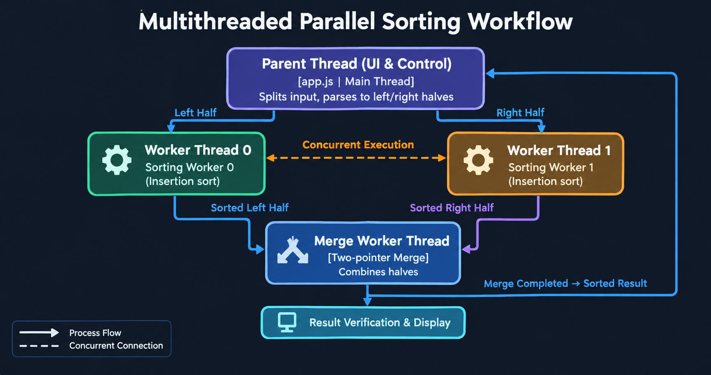

# F.CSM302 ҮЙЛДЛИЙН СИСТЕМ
## БИЕ ДААЛТ 1 - ТАЙЛАН

**Хичээлийн жил:** 2026–2027 оны хичээлийн жилийн намар  
**Сэдэв:** Multithreaded Sorting Application  
**Хичээл:** F.CSM302 — Үйлдлийн систем    
**Багийн дугаар:** V-1-6  
**Хичээл заасан багш:** [Г. Ганбат/F.CS10/]
**Гишүүд:** [О.Хишигжаргал/B210900026/ Л.Батзориг/B231910001/ Б.Эрдэнэжаргал/B241910003/ Б.Заяабуян/B241910026/ Б.Хүслэн/B241940015/ М.Мөнхүүжин/B242270135/] 
---

## Гарчиг

- [Хураангуй](#хураангуй)
- [1. Удиртгал](#1-удиртгал)
  - [1.1 Зорилго](#11-зорилго)
  - [1.2 Ач холбогдол](#12-ач-холбогдол)
  - [1.3 Хамрах хүрээ](#13-хамрах-хүрээ)
  - [1.4 Ажлын хуваарилалт](#14-ажлын-хуваарилалт)
- [2. Сурах бичгийн шаардлага](#2-сурах-бичгийн-шаардлага)
- [3. Онолын үндэс](#3-онолын-үндэс)
- [4. Системийн зохиомж](#4-системийн-зохиомж)
- [5. Хэрэгжилт](#5-хэрэгжилт)
- [6. Туршилт ба UI дүрслэл](#6-туршилт-ба-ui-дүрслэл)
- [7. Туршилтын арга](#7-туршилтын-арга)
- [8. Үр дүн](#8-үр-дүн)
- [9. Хэлэлцүүлэг](#9-хэлэлцүүлэг)
- [10. Дүгнэлт](#10-дүгнэлт)
- [Ашигласан материал](#ашигласан-материал)
- [Хавсралт](#хавсралт)

---

## Хураангуй

Энэхүү төслийн зорилго нь үйлдлийн системийн Threads & Concurrency сэдвийг олон урсгалт эрэмбэлэлтийн жишээгээр тайлбарлан харуулах юм. Програм нь бүхэл тоон жагсаалтыг хоёр хэсэгт хувааж, тус бүрийг хоёр тусдаа JavaScript Web Worker-ээр Insertion Sort алгоритмаар эрэмбэлнэ. Хоёр worker-ийн үр дүн бэлэн болсны дараа гурав дахь worker нь эрэмбэлэгдсэн хоёр хэсгийг нэгтгэнэ.

Хэрэглэгч жагсаалтыг гараар оруулах эсвэл санамсаргүйгээр үүсгэх, ажиллагааг эхлүүлэх, түр зогсоох, үргэлжлүүлэх, дахин тохируулах болон хөдөлгөөнт дүрслэлийн хурдыг өөрчлөх боломжтой. Үндсэн thread болон worker-үүд `postMessage()` ашиглан мессеж солилцдог. Эцсийн үр дүнг анхны өгөгдлийн эрэмбэлэгдсэн хувилбартай харьцуулж, зөв дараалал болон элементүүд хадгалагдсан эсэхийг шалгана.

**Түлхүүр үгс:** Operating System, Thread, Concurrency, Web Worker, Insertion Sort, Merge, `postMessage()`.

## 1. Удиртгал

Олон урсгалт боловсруулалт (Multithreading) нь програмын ажлыг хэд хэдэн гүйцэтгэлийн урсгалд хуваарилах ойлголт юм. Энэ нь тусдаа ажлуудыг зэрэг гүйцэтгэх боломж олгож, үндсэн хэрэглэгчийн интерфейсийг хариу үйлдэлтэй байлгахад тусалдаг. Үйлдлийн системийн Threads & Concurrency сэдвийг ойлгоход урсгалуудын ажлын хуваарилалт, мэдээлэл солилцоо болон гүйцэтгэлийн дарааллыг судлах шаардлагатай.

Энэ төслөөр бүхэл тоон жагсаалтыг хоёр хэсэгт хуваан, хоёр sorting worker-ээр зэрэг эрэмбэлж, дараа нь merge worker ашиглан нэгтгэх ажиллагааг интерактив дүрслэлээр харуулна.

### 1.1 Зорилго

- Олон урсгалт боловсруулалтын үндсэн зарчмыг практикт харуулах.
- Өгөгдлийн жагсаалтыг хоёр хэсэгт хувааж, тусдаа worker-үүдээр эрэмбэлэх.
- Эрэмбэлэгдсэн хоёр хэсгийг гурав дахь worker-ээр нэгтгэх.
- Үндсэн thread ба worker-үүдийн хооронд мессеж солилцох механизмыг хэрэгжүүлэх.
- Алгоритмын ажиллагааг хөдөлгөөнт дүрслэл болон удирдлагуудаар ойлгомжтой харуулах.
- Оролтын өгөгдөл болон эцсийн үр дүнгийн зөв байдлыг шалгах.

### 1.2 Ач холбогдол

- Thread болон зэрэгцээ боловсруулалтын ойлголтыг практик жишээгээр харуулна.
- Ажлыг хэсгүүдэд хувааж, үр дүнг нэгтгэх зарчмыг судална.
- Worker хооронд өгөгдөл дамжуулах болон ажиллагааг удирдах аргыг харуулна.
- Алгоритмын алхмуудыг дүрслэх нь эрэмбэлэлтийн ажиллагааг ажиглан ойлгоход тусална.

### 1.3 Хамрах хүрээ

Төсөл нь HTML, CSS, JavaScript болон Web Worker ашигласан браузерын програмыг хамарна. Оролтын хэмжээ 2–200 бүхэл тоо байна. Элементүүдийг хоёр хэсэгт хувааж, Insertion Sort ашиглан эрэмбэлээд, Merge ажиллагаагаар нэгтгэнэ. Интерфейс нь Start, Pause, Resume, Reset болон хурдны тохиргоотой.

Энэ нь браузерын Web Worker-ийн жишээ бөгөөд үйлдлийн системийн native thread-ийн бүх боломжийг хэрэгжүүлээгүй. Гүйцэтгэлийн үзүүлэлтэд хөдөлгөөнт дүрслэлийн хугацаа нөлөөлж болох тул нийт хугацааг зөвхөн алгоритмын цэвэр гүйцэтгэл гэж үзэхгүй.

### 1.4 Ажлын хуваарилалт

| Гишүүн | Хариуцсан ажил | Файл / үр дүн |
|---|---|---|
| [О.Хишигжаргал/B210900026/  | [Хариуцсан ажлыг бөглөнө] | [Файл эсвэл хэсэг] |
| [Л.Батзориг/B231910001/] | [Хариуцсан ажлыг бөглөнө] | [Файл эсвэл хэсэг] |
| [Б.Эрдэнэжаргал/B241910003/] | [Хариуцсан ажлыг бөглөнө] | [Файл эсвэл хэсэг] |
| [Б.Заяабуян/B241910026/] | [Хариуцсан ажлыг бөглөнө] | [Файл эсвэл хэсэг] |
| [Б.Хүслэн/B241940015/] | [Хариуцсан ажлыг бөглөнө] | [Файл эсвэл хэсэг] |
| [М.Мөнхүүжин/B242270135/] | [Хариуцсан ажлыг бөглөнө] | [Файл эсвэл хэсэг] |

## 2. Сурах бичгийн шаардлага

Төслийн чиглэл нь *Operating System Concepts*, Chapter 4 — Threads & Concurrency хэсэгт үздэг thread-ээр ажлыг хуваарилах ойлголттой холбоотой. Энэ төсөлд номын жишээний санааг браузерын Web Worker орчинд хэрэгжүүлсэн.

| Шаардлага | Төслийн хэрэгжилт |
|---|---|
| Жагсаалтыг хоёр хэсэгт хуваах | Үндсэн JavaScript код жагсаалтыг `Math.floor(n / 2)` байрлалаар хуваана. |
| Хоёр тусдаа sorting thread ашиглах | Хоёр Web Worker тус тусдаа хэсгийг эрэмбэлнэ. |
| Хэсэг бүрийг эрэмбэлэх | Worker бүр Insertion Sort алгоритм ашиглана. |
| Эрэмбэлсэн хэсгүүдийг нэгтгэх | Гурав дахь Web Worker `mergeWorkerMain()` функцээр хоёр хэсгийг нэгтгэнэ. |
| Worker-үүдэд өгөгдөл дамжуулах | `postMessage()`-ээр `sort` болон `merge` төрлийн мессеж дамжуулна. |
| Үр дүнг шалгах | Эцсийн жагсаалтын эрэмбэ болон анхны өгөгдөлтэй ижил элементтэй эсэхийг шалгана. |

**Хэрэгжилтийн ялгаа:** Web Worker нь ердийн байдлаар үндсэн thread-ийн хувьсагчийг шууд хуваалцдаггүй. Иймээс энэ төсөлд жагсаалтын хэсгүүдийг `postMessage()`-ээр worker бүрд дамжуулж, үр дүнг буцаан авдаг.

## 3. Онолын үндэс

### 3.1 Thread ба concurrency

Thread нь програмын гүйцэтгэлийн урсгал юм. Concurrency гэдэг нь хэд хэдэн ажлын гүйцэтгэлийг тодорхой хугацаанд давхцуулан зохицуулах ойлголт. Энэ төсөлд хоёр sorting worker өөр өөр өгөгдлийн хэсгийг боловсруулдаг.

### 3.2 Web Worker

Web Worker нь JavaScript кодыг үндсэн UI thread-ээс тусдаа гүйцэтгэх боломж олгодог. Үндсэн програм worker руу мессеж илгээхдээ `postMessage()` ашиглана. Worker үр дүн болон явцын мэдээллээ мөн мессежээр буцаана. Worker нь DOM-ийг шууд удирдахгүй; үндсэн thread нь ирсэн мессежээр интерфейсийг шинэчилнэ.

### 3.3 Insertion Sort

Insertion Sort нь элемент бүрийг өмнөх эрэмбэлэгдсэн хэсгийн тохирох байрлалд оруулдаг харьцуулалтад суурилсан алгоритм юм. Төслийн кодонд солилцоо бүрийг алхам болгон харуулах боломжтой.

- Хамгийн сайн тохиолдлын хугацаа: `O(n)`.
- Дундаж болон хамгийн муу тохиолдлын хугацаа: `O(n²)`.
- Нэмэлт санах ойн нийлмэл байдал: `O(1)` (in-place эрэмбэлэлтийн массивын хувьд).

Энэ алгоритмыг сонгосон шалтгаан нь алхамчилсан ажиллагааг дүрслэн тайлбарлахад ойлгомжтой байдагтай холбоотой.

### 3.4 Merge ажиллагаа

Merge нь эрэмбэлэгдсэн хоёр жагсаалтын одоогийн элементүүдийг харьцуулж, бага утгыг үр дүнгийн жагсаалтад дарааллаар нэмдэг. Хоёр жагсаалтын нийт элемент `n` бол хугацааны нийлмэл байдал `O(n)`, үр дүнгийн жагсаалт хадгалах санах ойн хэрэгцээ `O(n)` байна.

### 3.5 Worker-ийн төлөв ба мессеж

Worker-үүд `started`, `step`, `done` зэрэг төрлийн мессеж илгээдэг. Үндсэн thread эдгээрийг хүлээн авч дэлгэцийн дүрслэл, явцын төлөв болон эцсийн үр дүнг шинэчилнэ. `runId` нь өмнөх ажиллуулалтаас хоцорч ирсэн мессежийг үл тоомсорлоход ашиглагдана.

## 4. Системийн зохиомж

### 4.1 Бүрэлдэхүүн

1. **Үндсэн thread (`app.js`):** Оролт шалгах, ажил эхлүүлэх, worker-үүдийн мессеж хүлээн авах, UI шинэчлэх.
2. **Sorting Worker 1:** Жагсаалтын эхний хэсгийг Insertion Sort-оор эрэмбэлэх.
3. **Sorting Worker 2:** Жагсаалтын хоёр дахь хэсгийг Insertion Sort-оор эрэмбэлэх.
4. **Merge Worker:** Хоёр эрэмбэлэгдсэн хэсгийг нэгтгэх.
5. **Хэрэглэгчийн интерфейс (`index.html`, `styles.css`):** Оролт, товч, төлөв болон хөдөлгөөнт багануудыг харуулах.

### 4.2 Өгөгдлийн урсгал

```text
Хэрэглэгчийн оролт
       |
       v
Үндсэн thread: шалгах ба хоёр хуваах
       |                         |
       v                         v
Sorting Worker 1           Sorting Worker 2
       |                         |
       +-----------+-------------+
                   v
             Merge Worker
                   |
                   v
      Эцсийн үр дүн ба шалгалт
```

### 4.3 Өгөгдлийн бүтэц

Оролтын жагсаалт нь бүхэл тоон массив байна. Хуваасны дараа `left` болон `right` массивууд үүснэ. Sorting worker бүр өөрийн `values` массивыг эрэмбэлж, `done` мессежээр үр дүнг буцаана. Merge worker нь `left`, `right` массивуудыг хүлээн авч `result` массив үүсгэнэ.

### 4.4 UI-ийн зохиомж

Интерфейс нь тоонуудын оролт, санамсаргүй жагсаалт үүсгэх, хурд сонгох, Start/Pause/Resume/Reset удирдлага, хоёр sorting хэсгийн дүрслэл болон эцсийн үр дүнг агуулна. Баганын өндөр нь утгын хэмжээтэй уялдаж, өнгө нь боловсруулах болон эрэмбэлэгдсэн төлөвийг ялгахад тусална.

### 4.5 Дэлгэцийн зураг



**Зураг 1.** Multithreaded Sorting Application-ийн интерфейс.  


**Зураг 2.** Сурах бичгийн жишээ өгөгдөл.  



**Зураг 3.** Үндсэн thread, sorting worker-үүд болон merge worker-ийн өгөгдлийн урсгал.

## 5. Хэрэгжилт

### 5.1 Ашигласан хэл, технологи, орчин

- **HTML:** Интерфейсийн бүтэц.
- **CSS:** Загвар, баганан дүрслэл, хөдөлгөөнт эффект.
- **JavaScript:** Оролтын шалгалт, ажиллуулах логик, үр дүн шалгах.
- **Web Worker:** Эрэмбэлэлт болон нэгтгэлтийн ажлыг тусад нь гүйцэтгэх.
- **`postMessage()`:** Үндсэн thread ба worker хооронд өгөгдөл солилцох.
- **Blob URL:** Worker кодыг үүсгэж, `file://` горимоор шууд нээх боломжийг дэмжих.

### 5.2 Гол ажиллагаа

**Оролтыг шалгах.** Оруулсан утгыг таслал, зай эсвэл цэг таслалаар салгаж, бүхэл тоо эсэх болон зөвшөөрөгдсөн хэмжээг шалгана.

**Жагсаалтыг хуваах.** `half = Math.floor(values.length / 2)` гэж тооцоод эхний болон хоёр дахь хэсгийг үүсгэнэ. Элементийн тоо сондгой үед хоёр дахь хэсэг нэг элементээр олон байна.

**Эрэмбэлэх.** Хоёр sorting worker тус тусын хэсэг дээр Insertion Sort ажиллуулж, `step` мессежээр явцын мэдээлэл илгээнэ.

**Нэгтгэх.** Хоёр sorting worker хоёулаа дууссаны дараа merge worker ажиллана. `left[i] <= right[j]` харьцуулалтаар бага элементийг үр дүнд нэмж, үлдсэн элементүүдийг дарааллаар хуулна.

**Зөв байдлыг шалгах.** Эцсийн жагсаалт өсөх дараалалтай эсэх болон анхны жагсаалтын бүх элемент хадгалагдсан эсэхийг шалгана.

### 5.3 Pause, Resume ба Reset

Worker-үүд `pause`, `resume`, `delay` төрлийн мессежийг хүлээн авч ажиллагаагаа удирдана. `waitIfPaused()` нь дараагийн алгоритмын алхмын өмнө pause төлөвийг шалгана. Reset эсвэл шинэ ажил эхлэх үед `runId` өөрчлөгдөж, хуучин ажиллуулалтын хоцорсон мессежийг үл тоомсорлоно.

### 5.4 Оролтын шалгалт ба алдаа

Програм хоосон оролт, буруу формат, нэгээс цөөн элемент, 200-аас олон элемент, аюулгүй бүхэл тооны хязгаараас давсан утга болон worker үүсгэх/ажиллуулах алдааг шалгах боломжтой.

### 5.5 Репозиторийн бүтэц

```text
src/
  index.html
  styles.css
  app.js
  workers-code.js
tests/
  test-cases.md
docs/
  report.md
  image.png
  image-1.png
  image-2.png
README.md
```

## 6. Туршилт ба UI дүрслэл

### 6.1 Туршилтын жишээнүүд

| № | Оролт | Хүлээгдэх үр дүн | Шалгах зүйл |
|---|---|---|---|
| T1 | `5, 2, 8, 1, 3` | `1, 2, 3, 5, 8` | Энгийн эрэмбэлэлт |
| T2 | `1, 2, 3, 4, 5` | `1, 2, 3, 4, 5` | Аль хэдийн эрэмбэлэгдсэн оролт |
| T3 | `9, 7, 5, 3, 1` | `1, 3, 5, 7, 9` | Урвуу дараалал |
| T4 | `4, 2, 4, 1, 2` | `1, 2, 2, 4, 4` | Давхардсан утга |
| T5 | `-5, 3, -1, 0` | `-5, -1, 0, 3` | Сөрөг утга |
| T6 | `7, 7, 7, 7` | `7, 7, 7, 7` | Ижил утгууд |
| T7 | `8, 3, 1` | `1, 3, 8` | Сондгой хэмжээтэй жагсаалт |
| T8 | `5, 5` | `5, 5` | Хоёр элементтэй жагсаалт |

### 6.2 Буруу оролтын туршилт

| № | Оролт | Хүлээгдэх үр дүн |
|---|---|---|
| E1 | Хоосон оролт | Алдааны мэдэгдэл харуулах |
| E2 | `1, abc, 3` | Буруу оролтын мэдэгдэл харуулах |
| E3 | 200-аас олон элемент | Хэмжээний хязгаарын мэдэгдэл харуулах |
| E4 | Нэг элемент | Хамгийн багадаа хоёр бүхэл тоо шаардлагатай гэсэн мэдэгдэл |

### 6.3 UI-ийн гар шалгалт

| № | Үйлдэл | Шалгах зүйл | Бодит үр дүн |
|---|---|---|---|
| U1 | Start | Хоёр sorting worker эхлэх | [Туршилтын дараа бөглөнө] |
| U2 | Pause | Ажиллагаа түр зогсох | [Туршилтын дараа бөглөнө] |
| U3 | Resume | Ажиллагаа үргэлжлэх | [Туршилтын дараа бөглөнө] |
| U4 | Reset | Worker-үүд цэвэрлэгдэж UI дахин тохирох | [Туршилтын дараа бөглөнө] |
| U5 | Speed | Хөдөлгөөнт дүрслэлийн хурд өөрчлөгдөх | [Туршилтын дараа бөглөнө] |

## 7. Туршилтын арга

### 7.1 Орчин

- Програм: HTML, CSS, JavaScript, Web Worker.
- Хөтөч: [Ашигласан хөтчийн нэр, хувилбарыг бичнэ үү].
- Үйлдлийн систем: [Ашигласан үйлдлийн системийг бичнэ үү].
- Туршилтын огноо: [Огноо].

### 7.2 Туршилтын дараалал

1. `src/index.html` файлыг хөтөч дээр нээх эсвэл README-д заасан локал серверээр ажиллуулах.
2. Хүчинтэй оролтын жишээ оруулах.
3. Start дарж хоёр sorting worker-ийн ажиллагааг ажиглах.
4. Хоёр worker дууссаны дараа merge worker эхэлж буй эсэхийг шалгах.
5. Эцсийн үр дүнг хүлээгдэж буй жагсаалттай харьцуулах.
6. Сөрөг утга, давхардсан утга, сондгой хэмжээтэй жагсаалт болон буруу оролтын тестүүдийг давтах.
7. Pause, Resume, Reset болон хурдны удирдлагуудыг хөтөч дээр гараар шалгах.
8. Туршилтын үр дүнг тэмдэглэж, шаардлагатай дэлгэцийн зургуудыг хавсаргах.

### 7.3 Туршилтын шалгуур

- Эцсийн жагсаалт өсөх дарааллаар байрласан байх.
- Оролтын элементүүдийн тоо болон утгууд хадгалагдсан байх.
- Хоёр sorting worker хоёулаа дууссаны дараа нэгтгэл эхлэх.
- Буруу оролтод ойлгомжтой мэдэгдэл гаргах.
- Pause, Resume, Reset болон хурдны тохиргоо зөв ажиллах.

## 8. Үр дүн

Энэ хэсгийн хүснэгтэд бодит туршилтын үр дүнг оруулна. Туршилт хийж баталгаажуулаагүй мөрүүдийг амжилттай гэж тэмдэглэхгүй.

| Туршилт | Хүлээгдэж буй үр дүн | Бодит үр дүн | Төлөв |
|---|---|---|---|
| T1 — Энгийн эрэмбэлэлт | `1, 2, 3, 5, 8` | `1, 2, 3, 5, 8` | Амжилттай |
| T2 — Эрэмбэлэгдсэн оролт | `1, 2, 3, 4, 5` | `1, 2, 3, 4, 5` | Амжилттай |
| T3 — Урвуу дараалал | `1, 3, 5, 7, 9` | `1, 3, 5, 7, 9`  | Амжилттай |
| T4 — Давхардсан утга | `1, 2, 2, 4, 4` | `1, 2, 2, 4, 4` | Амжилттай |
| T5 — Сөрөг утга | `-5, -1, 0, 3` | `-5, -1, 0, 3`  | Амжилттай |
| T6 — Ижил утгууд | `7, 7, 7, 7, 7` | `7, 7, 7, 7, 7` | Амжилттай |
| T7 — Сондгой хэмжээтэй оролт | `1, 3, 8` | `1, 3, 8` | Амжилттай |
| T8 — Хоёр элемент | `5, 5` | `5, 5` | Амжилттай |
| E1 — Бүхэл тоон бус утга | Алдааны мэдэгдэл харуулах | `abc` нь бүхэл тоо биш гэсэн мэдэгдэл | Амжилттай |
| E2 — Хоосон оролт | Ойлгомжтой мэдэгдэл харуулах | Жагсаалт хоосон байна. Хоёр ба түүнээс олон бүхэл тоо оруулна уу. | Амжилттай |
| E3 — Хэмжээний хязгаараас олон элемент | Хязгаарын мэдэгдэл харуулах | Энэ хувилбар 200 хүртэлх элементийг дэмжинэ | Амжилттай |
| U1–U5 — UI удирдлага | Start, Pause, Resume, Reset, Speed зөв ажиллах | Тус бүрийн үр дүнг баталгаажуулах шаардлагатай | Хэсэгчлэн шалгасан |

**Үр дүнгийн тайлбар:** Найман хүчинтэй оролтын туршилт зөв эрэмбэлэгдсэн үр дүн өгсөн. Бүхэл тоон бус `abc` утгыг илрүүлж, алдааны мэдэгдэл харуулсан. Хоосон оролт, хэмжээний хязгаар болон UI удирдлагуудын бүх үр дүнг бүрэн баталгаажуулсны дараа эцсийн үнэлгээг гаргана.

## 9. Хэлэлцүүлэг

### 9.1 Үр дүнгийн тайлбар

Төслийн архитектур нь жагсаалтын хоёр хэсгийг тус тусад нь эрэмбэлж, дараа нь нэгтгэх байдлаар ажлыг хуваарилдаг. Worker-үүдийн тусдаа ажиллах байдал нь үндсэн UI thread-д алгоритмын алхмуудыг боловсруулах ачааллыг багасгаж, явцыг дүрслэх боломж олгодог. Гэхдээ worker ашигласан нь бүх оролтын хэмжээ, бүх төхөөрөмж дээр заавал хурдан ажиллана гэсэн үг биш; энэ төслийн гол зорилго нь зэрэгцээ ажиллагааны зарчмыг харуулах юм.

### 9.2 Хязгаарлалт

- Оролтын жагсаалтын хэмжээ 2–200 элементээр хязгаарлагдана.
- Insertion Sort-ийн дундаж болон хамгийн муу хугацааны нийлмэл байдал `O(n²)` тул том хэмжээний өгөгдөлд тохиромжтой алгоритм биш.
- Web Worker нь браузерын орчинд ажилладаг бөгөөд үйлдлийн системийн native thread-тэй бүх талаараа адил биш.
- Хөдөлгөөнт дүрслэл болон тохируулсан саатал нь нийт ажиллагааны хугацаанд нөлөөлнө.
- UI-ийн гар туршилтын үр дүнг тусад нь баталгаажуулж тайланд тэмдэглэх шаардлагатай.

## 10. Дүгнэлт

Энэхүү төслөөр Threads & Concurrency сэдвийн үндсэн ойлголтыг JavaScript Web Worker ашиглан практикт харуулах системийн загвар боловсруулсан. Оролтын жагсаалтыг хоёр хэсэгт хувааж, хоёр sorting worker-ээр Insertion Sort ажиллуулан, гурав дахь worker-ээр үр дүнг нэгтгэдэг. `postMessage()`-ийн тусламжтайгаар worker-үүд болон үндсэн thread мэдээлэл солилцож, UI нь эрэмбэлэлтийн явцыг харуулдаг.

Төслийн эцсийн үнэлгээг гаргахын тулд тестийн төлөвлөгөөнд байгаа хүчинтэй болон буруу оролтын жишээнүүдийг ажиллуулж, UI-ийн удирдлагуудыг шалгаж, бодит үр дүнг 8-р бүлэгт бүртгэх шаардлагатай.

## Ашигласан материал

1. Silberschatz, A., Galvin, P. B., Gagne, G. *Operating System Concepts*, 10th Edition, Chapter 4 — Threads.
2. MDN Web Docs. *Web Workers API*.
3. MDN Web Docs. *Worker.postMessage()* болон `message` event-ийн баримт бичиг.
4. V-1-6 багийн төслийн `README.md`, `src/app.js`, `src/workers-code.js`, `tests/test-cases.md` файлууд.

## Хавсралт

### Хавсралт A. Туршилтын дэлгэцийн зураг

[Туршилт амжилттай болсон бодит дэлгэцийн зургийг энд оруулна уу.]

### Хавсралт B. Төслийн эх код

Эх кодыг репозиторийн `src/` хавтсанд, тестийн төлөвлөгөөг `tests/test-cases.md` файлд байршуулсан.
